<div align="center">



<a href="https://github.com/Sachitbansal">
  
</a>

<br/>

<a href="https://sachitbansal.sbssdigital.com/"></a>
<a href="https://x.com/SachitBansal20"></a>


</div>

<br/>



## `> ls ~/recent --sort=time`

<table>
<tr>
<td width="50%" valign="top">

### 🔬 [researchAgent](https://github.com/Sachitbansal/researchAgent)
An agentic research assistant over arXiv. Ask a question; it picks its own tools, retrieves evidence, **reads figures with a vision model** when the text isn't enough, NLI-checks its own draft and puts a citation on every claim, or **abstains** when the corpus can't support an answer.

`no agent framework` · `bi-encoder → cross-encoder rerank` · `FAISS` · `BGE` · `DeBERTa NLI` · `PyMuPDF`

</td>
<td width="50%" valign="top">

### 📡 [XBot](https://github.com/Sachitbansal/XBot)
A personal content radar. Pulls HN, arXiv, GitHub trending, RSS and X, dedupes, scores everything with an LLM and drafts posts only for what clears the bar. Every draft goes through a **Telegram approve / edit / reject loop**, and each decision is logged to Postgres.

`Python` · `LLM scoring` · `Telegram bot` · `PostgreSQL` · `Docker` · `cron`

</td>
</tr>
<tr>
<td width="50%" valign="top">

### 🧭 [dlHack](https://github.com/Sachitbansal/dlHack): vision-language navigation
A vision-language navigation (VLN) stack designed to fit in **24 GB of VRAM**: a QLoRA-tuned Qwen2.5-VL / StreamVLN core, a topo-metric map for spatial memory, and Redis + Qdrant for landmark retrieval and caching.

`Qwen2.5-VL` · `QLoRA` · `Qdrant` · `Redis` · `RxR`

</td>
<td width="50%" valign="top">

### 🏦 [CustomerTargetting](https://github.com/Sachitbansal/CustomerTargetting)
A real-time banking feature pipeline. Table streams are published over NATS, client features are computed incrementally in memory, and the results are pushed downstream for **online customer segmentation**.

`NATS` · `streaming` · `online GMM` · `Pathway` · `Redis`

</td>
</tr>
<tr>
<td width="50%" valign="top">

### 🩻 [DLA-MRI-To-CT](https://github.com/Sachitbansal/DLA-MRI-To-CT)
Deep-learning image-to-image translation that synthesises CT scans from MRI.

`deep learning` · `medical imaging` · `image-to-image`

</td>
<td width="50%" valign="top">

### ♛ [royalchess](https://github.com/Sachitbansal/royalchess)
A full-stack real-time chess platform (play, spectate, chat), packaged as a **hands-on Docker challenge** with multi-stage builds, compose networking and persistent Postgres.

`Next.js` · `Socket.io` · `Express` · `PostgreSQL` · `Docker`

</td>
</tr>
</table>

<details>
<summary><b>📦 Earlier builds</b></summary>
<br/>

| Project | Stack | What it does |
|---|---|---|
| **Air-gapped doc compliance** | `Qwen3-14B/32B` `Ollama` `vLLM` `LoRA` | Hybrid deterministic + local-LLM checker for classified documents, fully offline |
| **NARC** | `LinUCB` `contextual bandits` `MIND` | Hyper-personalised news recommender (CS671 hackathon) |
| **Sootrank ERP** | `Django` `PostgreSQL` `Redis` `Docker` | Academic ERP for IIT Mandi: audited it and shipped fixes |
| **[DocuMindAI](https://github.com/Sachitbansal/DocuMindAI)** | `RAG` `FAISS` `LangChain` | Retrieval-augmented document intelligence |
| **[Foundry](https://github.com/Sachitbansal/Foundry) · [voting-dapp](https://github.com/Sachitbansal/voting-dapp)** | `Solidity` `Foundry` | Smart contracts, tests and dApp front-ends |
| **[AirSimLab](https://github.com/Sachitbansal/AirSimLab)** | `AirSim` `robotics` | Drone and vehicle simulation experiments |

</details>

## `> cat stack.yml`

<div align="center">

<br/>
<br/>


<br/>


</div>

## `> ./off-hours.sh`

```diff
+ CTFs          KashiCTF, R3CTF: reverse engineering (LD_PRELOAD hooks, ELF trampolines),
+               crypto (RSA edge cases, GF(2) linear algebra), OSINT, network forensics, pwn
+ Algorithms    CSES + LeetCode: DP, graphs, segment trees, union-find, backtracking
+ Teaching      KP Dev Cell sessions at IIT Mandi on Git, React, FastAPI, Docker, OAuth
! Next          a Werkstudent role in AI / ML engineering in Germany. Let's talk.
```

## `> top -u sachit`

<div align="center">


<br/><br/>

<picture>
  <source media="(prefers-color-scheme: dark)" srcset="https://raw.githubusercontent.com/Sachitbansal/Sachitbansal/output/snake-dark.svg" />
  <source media="(prefers-color-scheme: light)" srcset="https://raw.githubusercontent.com/Sachitbansal/Sachitbansal/output/snake.svg" />
  
</picture>

<sub>🐍 game mode: a snake eats my contribution graph, regenerated every 12h by <a href=".github/workflows/profile.yml">a workflow in this repo</a></sub>

<br/><br/>



</div>
